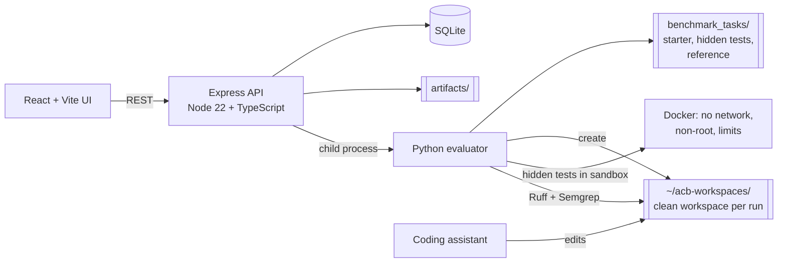

# Agentic Coding Assistants: A Comparative Evaluation Platform

A local research platform for a controlled comparison of **GitHub Copilot, Cursor, Claude Code and
OpenAI Codex** on a project-specific suite of 18 synthetic Python software-engineering tasks.
It creates clean task workspaces, guides a researcher through each attempt, evaluates submissions
with hidden tests, Ruff and Semgrep, stores every run with full provenance, and exports
analysis-ready data.

DTU B.Tech Project-I, AY 2026–27, Group A6 (Sambhav Gupta, Sameer, Saurabh Suman; guide
Dr. Pawan Singh Mehra).

> The repository contains **no experimental results**. The planned study is 18 tasks × 4 assistants
> × 2 attempts = 144 attempts; numbers appear only after real runs are evaluated. No demo or
> fabricated data is shipped or exported.


## Benchmarks: custom suite, SWE-bench Verified pilot and Golden

The app runs three benchmarks side by side; every page has a benchmark switch and they are never pooled.

- **Custom suite**: 18 synthetic Python tasks (6 categories), scored by this project's evaluator. Works out of the box.
- **Golden**: 247 tasks from the golden dataset (`golden/`) in six domains: bug fix 113, feature implementation 52,
  security fix 26, frontend/visual 25, refactoring 17, performance 14. They come from SWE-bench Verified, Multilingual,
  Multimodal and Pro, and the issue text ships with the repo (no download). A reviewed **balanced core** of 5 tasks
  per domain (30 tasks, `golden/configs/core_review.yaml`) is the default selection for a Golden experiment, and the
  Results page reports a **domain-balanced success rate** (mean of per-domain rates) so bug fixes cannot dominate the
  headline score.
  Two more golden Verified issues are already pilot tasks; they stay in the pilot and show their golden domain.
  Scoring:
  - Verified, Multilingual and Multimodal tasks use the official SWE-bench harness (Docker setup below); each task
    passes its own dataset name and split to it.
  - SWE-bench Pro tasks run in the task's published Docker image with Pro's test scripts. One-time setup:
    `git clone https://github.com/scaleapi/SWE-bench_Pro-os` and set `ACB_SWEBENCH_PRO_SCRIPTS` to its
    `run_scripts` folder (in `.env`). Pro images are large (several GB each); pull them on first use.
- **SWE-bench Verified**: 12 real GitHub issues, scored by the official SWE-bench harness in Docker. One-time setup:

```
pip install -r requirements-swebench.txt        # swebench + datasets (free)
python swebench_pilot/pilot.py select --ids-from swebench_pilot/candidates.json   # downloads issue text from Hugging Face
# then press "Synchronise tasks" on the Dashboard (or restart the backend); Docker must be running for scoring
```

On Windows, run SWE-bench scoring from WSL2 (Ubuntu) with Docker Desktop's WSL integration (the harness does not
support native Windows). You can run straight from the Windows folder (`/mnt/d/...`). In that case the WSL copy keeps
its own database in `~/.acb/acb.sqlite`, because SQLite cannot share a database file on a Windows drive. Stop the
Windows copy of the app before starting the WSL one, since both use ports 4000 and 5173. To keep everything in one
database, run all experiments (custom and SWE-bench) from WSL.

If a SWE-bench evaluation fails with "Docker engine is not reachable" or a `DockerException ... No such file or
directory`, Ubuntu cannot see Docker. In Docker Desktop open **Settings > Resources > WSL integration**, turn on your
Ubuntu distribution, click **Apply & restart**, and check that `docker info` works in the Ubuntu terminal. Then press
**Re-evaluate submission** on the run; the recorded session is kept.

The app picks the dataset name that matches the installed harness: `SWE-bench/SWE-bench_Verified` for
swebench 5.x (prebuilt Docker images, faster) and `princeton-nlp/SWE-bench_Verified` for older versions.

How runs are evaluated and turned into scores, plus all key links: `docs/scoring-and-key-links.md`.

## Golden dataset (`golden/`)

A 350-task, 8-domain golden dataset built from SWE-bench Verified, SWE-bench+, SWE-Bench++, SWE-bench Pro,
Multimodal, Multilingual, SWE-rebench and NYU CTF Bench (the EnIGMA benchmark). It comes with automatic quality
gates (solution leakage, weak tests, duplicates), calibrated difficulty, a code-quality module (complexity,
maintainability, lint, bandit, stray files, patch size) and a per-task analysis of 9 published agents.

| What | Where |
|---|---|
| Dataset (JSONL, Parquet, per-domain splits) | `golden/dataset/golden_v1.0.0.*`, `golden/dataset/by_domain/` |
| Datasheet and build manifest | `golden/dataset/DATASHEET.md`, `golden/dataset/manifest.json` |
| Human review sheet | `golden/dataset/review_sheet.csv` |
| Tasks this app runs (Golden benchmark, incl. balanced core) | `golden/dataset/app_tasks.json` |
| Results, figures, research write-up | `golden/reports/RESULTS.md`, `golden/reports/figures/`, `golden/reports/RESEARCH_REPORT.md` |

```
cd golden
pip install -r requirements.txt
python -m agentbench export-app            # rewrite the app's task file and balanced core (offline)
python -m agentbench build --reuse-pool    # re-sample from the cached pool (offline if golden/.cache exists)
python -m agentbench all                   # full rebuild: download, gate, sample, evaluate, report (slow)
python -m pytest -q tests
```

Details: `golden/README.md`. `.github/workflows/golden-refresh.yml` rebuilds the dataset weekly and opens a PR.

## Research paper (IEEE outline)

The project now also covers the paper in the outline, "Agentic Coding Assistants: A Comparative Study of
GitHub Copilot, Cursor, Claude Code and Codex":

- `paper/` holds the IEEE LaTeX paper (`main.tex`, compiled `main.pdf`) and `literature-summary.md`.
- `evidence/` holds the verified literature registry, shown in the UI under **Literature evidence**.
- `analysis/aidev/` re-analyses the public AIDev dataset of agent-authored PRs.
- `swebench_pilot/` runs a human-operated SWE-bench Verified pilot of the four assistants.

Status and remaining steps: `docs/next-steps-paper-outline.md`. Literature figures are published values from
cited sources, never results of this platform.

## Contents

- [Research objective and scope](#research-objective-and-scope)
- [Architecture](#architecture)
- [Technology stack](#technology-stack)
- [Prerequisites](#prerequisites)
- [Setup on Windows (PowerShell)](#setup-on-windows-powershell)
- [Setup on macOS / Linux](#setup-on-macos--linux)
- [Configuration](#configuration)
- [Running the app](#running-the-app)
- [Database and migrations](#database-and-migrations)
- [Benchmark tasks and validation](#benchmark-tasks-and-validation)
- [Running the evaluator directly](#running-the-evaluator-directly)
- [Conducting a human-operated experiment](#conducting-a-human-operated-experiment)
- [Assistant integrations](#assistant-integrations)
- [Exporting results and reproducing the analysis](#exporting-results-and-reproducing-the-analysis)
- [Tests](#tests)
- [Team workflow](#team-workflow)
- [Troubleshooting](#troubleshooting)
- [Security limitations](#security-limitations)
- [Research limitations](#research-limitations)
- [Repository layout](#repository-layout)

## Research objective and scope

Research questions (from the research plan):

* **RQ1** What proportion of attempts pass the acceptance checks for each assistant configuration?
* **RQ2** How does performance vary across the six task categories and difficulty levels?
* **RQ3** How often do regressions, lint findings, security findings, long sessions and human
  interventions occur for each configuration?

The platform measures functional success, efficiency (duration, iterations, interventions),
code quality (Ruff), security (Semgrep), regressions and out-of-scope changes, and records a
failure-mode taxonomy. Definitions and denominators: [docs/metrics-and-data-dictionary.md](docs/metrics-and-data-dictionary.md).
Procedure: [docs/experimental-protocol.md](docs/experimental-protocol.md).

The suite is **synthetic and project-specific**. It is not SWE-bench and does not show how the
assistants behave on real-world repositories in general.

## Architecture



Details, data model and security model: [docs/architecture.md](docs/architecture.md).
API reference with examples: [docs/api.md](docs/api.md).

## Technology stack

| Layer | Technology |
|---|---|
| Frontend | React 19, TypeScript, Vite, Tailwind CSS v4, D3 (scales) + SVG charts |
| Backend | Node.js ≥ 22.13, TypeScript (run with `tsx`), Express 5, zod validation, JSON structured logging |
| Persistence | SQLite through Node's built-in `node:sqlite` (no native build); JSON/JSONL/CSV artifacts |
| Evaluator | Python 3.12 (3.10+ works), pytest, Ruff, Semgrep, Docker sandbox |
| Analysis | pandas, SciPy, matplotlib |
| Tests | pytest, `node:test`, React server rendering, Playwright end-to-end smoke test |
| CI | GitHub Actions (`.github/workflows/ci.yml`) |

## Prerequisites

* **Node.js 22.13 or newer** (22 LTS or 24 LTS) — `node --version`
* **Python 3.12** (3.10+ works) — `python --version` (Windows: `py -3.12 --version`)
* **Git** — used to initialise workspaces and apply patches
* **Docker Desktop** — recommended for sandboxed evaluation (free for students)
* **Semgrep** — optional but needed for security metrics (see below)
* 16 GB RAM is plenty; no GPU is needed.

## Setup on Windows (PowerShell)

```powershell
cd D:\path\to\agentic-coding-benchmark
node --version              # must be v22.13 or newer
py -3.12 --version

npm install                 # Node packages for backend + frontend
npm run setup               # creates .env and .venv, installs Python packages, validates the 18 tasks

# Docker evaluation sandbox (Docker Desktop must be running)
npm run docker:evaluator

# Semgrep: pip install in the venv, or run it from Docker
.\.venv\Scripts\python.exe -m pip install semgrep
# if that fails on Windows, add this line to .env instead:  ACB_SEMGREP_DOCKER=1

notepad .env                # set ACB_OPERATOR=<your name>; keep ACB_EVAL_MODE=docker
npm run dev                 # open http://127.0.0.1:5173
```

If `npm run setup` cannot find Python, create the environment by hand and re-run:

```powershell
py -3.12 -m venv .venv
.\.venv\Scripts\python.exe -m pip install -r requirements.txt
npm run setup
```

## Setup on macOS / Linux

```bash
cd agentic-coding-benchmark
node --version              # v22.13+
python3 --version           # 3.12 recommended

npm install
npm run setup               # .env, .venv, Python packages, task validation
npm run docker:evaluator    # build the sandbox image (Docker running)
.venv/bin/pip install semgrep
$EDITOR .env                # set ACB_OPERATOR
npm run dev                 # http://127.0.0.1:5173
```

## Configuration

All settings live in `.env` (created from `.env.example`; never commit it). The most important:

| Variable | Default | Meaning |
|---|---|---|
| `ACB_OPERATOR` | OS user name | Recorded on every run and experiment |
| `ACB_EVAL_MODE` | `docker` | `docker` (sandboxed) or `local` (no isolation; explicit opt-in only) |
| `ACB_WORKSPACE_ROOT` | `~/acb-workspaces` | Where clean workspaces are created; **must be outside the repository** (enforced) |
| `ACB_DB_PATH` | `./data/acb.sqlite` | SQLite database |
| `ACB_ARTIFACT_ROOT` | `./artifacts` | Evaluation reports, logs, patches, exports |
| `ACB_PYTHON` | `.venv` interpreter | Python used to run the evaluator |
| `ACB_SEMGREP_BIN` / `ACB_SEMGREP_DOCKER` | — | Where to find Semgrep |
| `ACB_ENABLE_AUTOMATION` | `0` | Enable headless CLI adapters (see integrations) |

Relative paths are resolved from the repository root; `~` means your home folder.

## Running the app

| Command | What it does |
|---|---|
| `npm run dev` | API on http://127.0.0.1:4000 and UI on http://127.0.0.1:5173 with hot reload |
| `npm start` | Builds the UI and serves it from the API at http://127.0.0.1:4000 |
| `npm run dev --workspace backend` | API only |
| `npm run dev --workspace frontend` | UI only (expects the API on port 4000) |

On start-up the API applies migrations, recovers interrupted evaluations, synchronises the 18 tasks
from `benchmark_tasks/` and detects installed assistant CLIs.

## Database and migrations

Nothing to do manually: the database file is created and migrated on first start. Migrations are
append-only (`backend/src/db/migrations.ts`) and recorded in `schema_migrations`. To start fresh,
stop the server and delete `data/acb.sqlite` (and `artifacts/runs/` if you also want to drop logs).
Back up `data/` and `artifacts/` after each working session. Moving to PostgreSQL later is described
in [docs/architecture.md](docs/architecture.md#migrations-and-moving-to-another-database).

## Benchmark tasks and validation

| ID | Task | Category | Difficulty | Time limit |
|---|---|---|---|---|
| BF-01 | Pagination boundary errors | bug fixing | easy | 20 min |
| BF-02 | Retry-limit and backoff logic | bug fixing | medium | 25 min |
| BF-03 | Duration parser input handling | bug fixing | medium | 25 min |
| FI-01 | Catalog filtering and sorting | feature implementation | easy | 20 min |
| FI-02 | Cursor-based pagination for a note store | feature implementation | medium | 30 min |
| FI-03 | Structured registration validation | feature implementation | hard | 35 min |
| SR-01 | Unsafe SQL query construction | security remediation | easy | 20 min |
| SR-02 | Path traversal prevention in file storage | security remediation | medium | 25 min |
| SR-03 | Unsafe deserialization of session tokens and settings | security remediation | medium | 30 min |
| RF-01 | Remove duplicated CSV export logic | refactoring | easy | 20 min |
| RF-02 | Isolate responsibilities in the order service | refactoring | medium | 30 min |
| RF-03 | Replace plan conditionals with an extensible plan registry | refactoring | hard | 35 min |
| TW-01 | Edge-case tests for a text statistics module | test writing | easy | 25 min |
| TW-02 | Tests for a stateful inventory ledger | test writing | medium | 30 min |
| TW-03 | Tests for an interval scheduling module | test writing | hard | 35 min |
| RR-01 | Trace a checkout total mismatch across modules | repository reasoning | medium | 30 min |
| RR-02 | Missing audit events and ignored audit setting | repository reasoning | hard | 35 min |
| RR-03 | Add a validated ISBN field end to end | repository reasoning | hard | 40 min |

Each task folder has `task.json` (metadata, scope, acceptance-test descriptions), `prompt.md`
(the frozen prompt), `starter/` (what the assistant sees), `grading/` (hidden acceptance and
regression tests, or mutants for test-writing tasks) and `reference/` (solution used only for
validation). Refactoring tasks check behaviour preservation plus structure (AST checks); test-writing
tasks are judged by pass-on-original, test count, line coverage and mutation score.

Validate all tasks:

```bash
npm run validate:tasks                                  # mode from ACB_EVAL_MODE (docker by default)
node scripts/py.mjs -m evaluator.cli validate --mode local
node scripts/py.mjs -m evaluator.cli validate --task SR-02 --mode docker
```

Validation checks that every starter **fails** at least one acceptance check, every reference
**passes** acceptance and regression tests and stays in scope, every mutant is detectable, and that
prompts and starters contain no hidden material. Results are written to
`benchmark_tasks/_validation/` with the task hash; changing a task makes its validation *stale*.
Commit these files. A second-person prompt review is also required
([docs/task-review-log.md](docs/task-review-log.md)).

## Running the evaluator directly

```bash
node scripts/py.mjs -m evaluator.cli list-tasks
node scripts/py.mjs -m evaluator.cli show-task BF-02
node scripts/py.mjs -m evaluator.cli create-workspace BF-02 ../scratch/bf02
# ... edit ../scratch/bf02 ...
node scripts/py.mjs -m evaluator.cli evaluate --task BF-02 --workspace ../scratch/bf02 --out ../scratch/bf02-report --mode docker
node scripts/py.mjs -m evaluator.cli env --mode docker     # tool and sandbox availability
```

The report (`report.json`, schema in `schemas/evaluation-report.schema.json`) contains the verdict,
per-test outcomes, diff and scope check, Ruff and Semgrep results (new versus baseline), tool
versions and timings. Missing tools are reported as `unavailable`, never as zero findings.

## Conducting a human-operated experiment

1. **Assistants page:** check each assistant and type the version/model you are using if it was not
   detected.
2. **Experiments → New experiment:** keep all 18 tasks, all 4 assistants and 2 attempts. The panel
   shows **144 planned attempts**. Review and create, then *Start experiment*.
3. Click **Open next run in order** (randomised order with a recorded seed).
4. **Create workspace**, copy the path and open that folder in the assistant (VS Code + Copilot agent,
   Cursor agent, or a terminal running `claude` / `codex`). Never open the repository itself.
5. **Start session timer**, then **Copy frozen prompt** and paste it into a new session.
6. While the assistant works, use **Log follow-up prompt** and **Log intervention** (definitions in
   the protocol, §4).
7. When it is done, **Stop timer** and **Submit and evaluate** (files in the workspace folder, or a
   pasted diff). Results appear on the run page within seconds to a minute.
8. If something unrelated to the assistant breaks, **Mark operational failure** and **Retry
   attempt**; if the protocol was violated, **Invalidate run**. History is always kept.

## Assistant integrations

| Assistant | Human-operated | Headless adapter | Status out of the box |
|---|---|---|---|
| GitHub Copilot | VS Code agent mode | Copilot CLI (`copilot -p`) | Requires manual execution unless the CLI is installed |
| Cursor | Cursor agent | Cursor CLI (`cursor-agent -p`) | Requires manual execution unless the CLI is installed |
| Claude Code | `claude` in a terminal | `claude -p` | Requires manual execution unless the CLI is installed |
| OpenAI Codex | `codex` in a terminal | `codex exec` | Requires manual execution unless the CLI is installed |

No adapter was run against a real product during development, and automation is **disabled by
default** (`ACB_ENABLE_AUTOMATION=0`), so the platform never calls a paid service on its own. To
enable and verify adapters see [docs/assistant-integrations.md](docs/assistant-integrations.md).

## Exporting results and reproducing the analysis

Exports page, or the API/CLI:

```bash
npm run export -- <experiment-id>      # all formats + CHECKSUMS.json into artifacts/exports/<timestamp>-<id>/
npm run analyze -- --input artifacts/exports/<folder>/results-<id>.csv --out analysis/output
```

| File | Content |
|---|---|
| `runs-*.jsonl` | Raw run records (every run, including retries, failed and invalidated) with evaluation history |
| `results-*.csv` | Normalised one-row-per-run table; filter `is_effective_run` and `eligible_for_success` |
| `experiment-config-*.json` | Frozen configuration, task versions, prompt hashes, planned matrix |
| `summary-*.csv` | Aggregates with sample sizes and Wilson intervals |
| `data-dictionary.json/.md` | Field definitions |
| `manifest-*.json` | Platform, evaluator, tool, assistant and task versions observed |
| `bundle-*.json` | Checksummed experiment bundle for team exchange |

`analysis/analyze.py` writes descriptive tables, plots, a missing-data table and — separately —
exploratory paired tests (Cochran's Q, exact McNemar with Holm correction, Friedman on durations)
to `REPORT.md`. With no eligible records it writes an explicit "no data" message and no tables.

## Tests

```bash
npm test                 # Python (evaluator, tasks, schemas, analysis) + backend + frontend
npm run test:python
npm run test:backend     # unit, API integration, lifecycle, recovery, adapters, import/export
npm run test:frontend    # components and views rendered on the server
npm run typecheck
npm run test:e2e         # needs: npx playwright install chromium
```

Test status at delivery is listed in [docs/test-report.md](docs/test-report.md).

## Team workflow

| Member | Role (research plan) | Main areas in this repository |
|---|---|---|
| Sambhav Gupta | Orchestration, API runner integration, workspace isolation | `backend/`, adapters, workspaces, Docker |
| Sameer | Task suite, acceptance harness, static analysis | `benchmark_tasks/`, `evaluator/`, Ruff/Semgrep config, validation |
| Saurabh Suman | Benchmark execution, failure taxonomy, statistics | experiment runs, labelling, `analysis/`, exports, report |

* Everyone clones the repository and runs `npm install && npm run setup`. Each person has their own
  database and sets a distinct `ACB_OPERATOR`.
* One person creates the official experiment and exports its **bundle**; the others import it
  (Exports page). Split execution by assistant so no attempt is run twice.
* After each session, export a bundle and share it; importing is idempotent and never overwrites a
  conflicting record. Share `artifacts/runs/<run-id>/` folders too if others need the logs.
* Task or protocol changes go through a pull request, bump the task version and re-run validation.

## Troubleshooting

| Problem | Fix |
|---|---|
| `node:sqlite` not found / experimental warning errors | Use Node 22.13+ (`node --version`). |
| "Cannot start Python" / tasks list is empty | Run `npm run setup`, or set `ACB_PYTHON` in `.env` to your interpreter. |
| Evaluation fails with `execution_unavailable` | Start Docker Desktop and run `npm run docker:evaluator`, or set `ACB_EVAL_MODE=local` for exploratory work only. |
| Semgrep shows "unavailable" | Install Semgrep or set `ACB_SEMGREP_DOCKER=1`. Security metrics are missing, not zero, until then. |
| "ACB_WORKSPACE_ROOT must be outside the repository" | Point it to a folder outside the project. |
| Patch submission rejected | Make sure the patch was produced from the run's workspace (`git diff` inside it). |
| Task shows *stale* validation | The task changed; run `npm run validate:tasks` and commit `_validation/`. |
| Port 4000 or 5173 busy | Set `PORT` in `.env`; for the UI set `ACB_API_URL` when running Vite. |
| Windows: adapter "cannot safely execute .cmd" | Set the adapter override to `["node","<path to cli.js>",…]`. |

## Security limitations

The app is for **trusted local research use**: it binds to 127.0.0.1 and has no authentication.
Local evaluation mode runs submitted code without isolation; Docker mode limits network, filesystem
and resources but runs tests in the same process as submitted code. No endpoint executes arbitrary
commands. See [docs/architecture.md](docs/architecture.md#security-model) and
[docs/research-limitations.md](docs/research-limitations.md).

## Research limitations

Synthetic tasks, three per category, 36 attempts per assistant, human-operator effects, products
that change during the study, and pattern-based static analysis all limit what can be concluded.
Read [docs/research-limitations.md](docs/research-limitations.md) before writing results, and see
[docs/requirements-and-conflicts.md](docs/requirements-and-conflicts.md) for decisions that need the
team's confirmation.

## Repository layout

```
agentic-coding-benchmark/
  backend/            Express API (routes, services, repositories, db, adapters) + tests
  frontend/           React UI (pages, components, lib) + tests
  evaluator/          Python evaluator CLI, sandbox runner, static analysis, validation
  benchmark_tasks/    18 tasks in 6 category folders + _validation/
  golden/             golden dataset pipeline, dataset, code-quality module, published-agent analysis
  swebench_pilot/     12-issue SWE-bench Verified pilot (candidates, manifest, pilot.py)
  analysis/           analyze.py (descriptive + exploratory inferential statistics)
  schemas/            JSON Schemas for task.json and evaluator reports
  scripts/            setup, dev, cross-platform Python launcher
  tests/              Python tests (evaluator, schemas, analysis) + e2e smoke test
  docker/             evaluator sandbox Dockerfile
  docs/               protocol, metrics, architecture, API, integrations, reproducibility, limitations
  artifacts/          run reports, logs, patches and exports (git-ignored)
```
