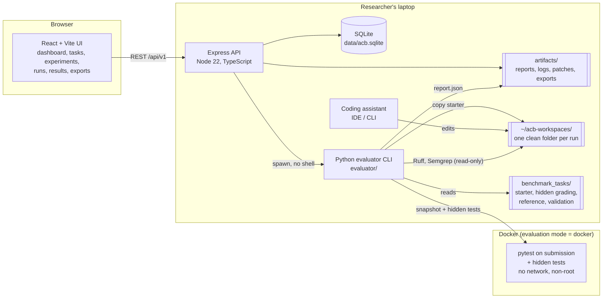
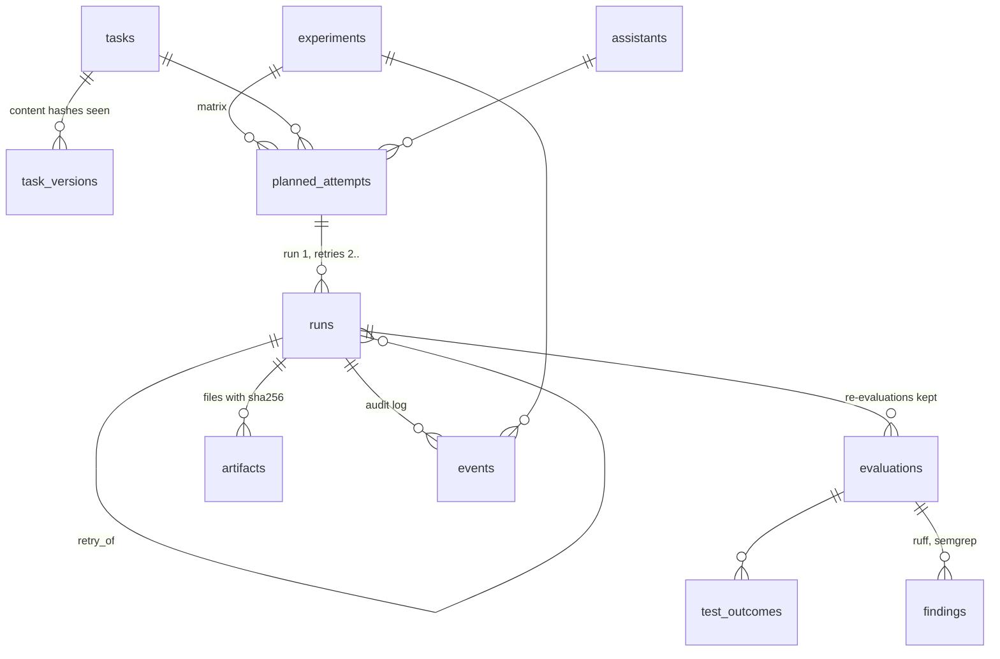

# Architecture

## Overview

* **Frontend** (`frontend/`): React 19, TypeScript, Vite, Tailwind CSS v4. Charts use D3 scales and
  plain SVG. A small history-API router avoids extra dependencies. Views are pure components
  (`DashboardView`, `ResultsView`, `TasksView`) wrapped by data-loading containers, which makes them
  testable with server-side rendering.
* **Backend** (`backend/`): Express 5 REST API. Layers:
  `routes/` (HTTP + zod validation) → `services/` (business logic) → `repositories/` (all SQL) →
  `db/` (node:sqlite wrapper and migrations). Structured JSON logging with secret redaction;
  central error handler that maps validation, not-found, conflict and payload errors to JSON.
* **Evaluator** (`evaluator/`): standalone Python package and CLI. The backend calls it as a child
  process (`python -m evaluator.cli …`) with an argument list (never a shell). It discovers tasks,
  computes content hashes, creates workspaces, evaluates submissions and validates tasks.
* **Benchmark tasks** (`benchmark_tasks/<category>/<ID>_<slug>/`): `task.json`, `prompt.md`,
  `starter/` (copied to workspaces), `grading/` (hidden acceptance and regression tests, or mutants),
  `reference/` (overlay used only for validation). Validation records live in
  `benchmark_tasks/_validation/`.
* **Analysis** (`analysis/analyze.py`): offline statistics from exported CSV/JSONL.

## Why these choices

| Decision | Reason |
|---|---|
| SQLite via `node:sqlite` | Zero native add-ons to compile on Windows laptops; one file per team member; transactions and constraints. Requires Node ≥ 22.13. |
| Evaluator in Python, called as a CLI | Same language as the tasks; usable on its own; isolates submitted code from the API process. |
| Workspaces outside the repository | An agent that browses its working folder cannot reach hidden tests or reference solutions. The backend refuses a workspace root inside the repository. |
| Hidden tests copied only into a temporary evaluation directory | The workspace never contains grading material. |
| Fixed Ruff/Semgrep configuration passed explicitly | A submission cannot change the rule set by adding config files. |
| Single in-process evaluation queue (concurrency 1) | Deterministic timing on a 16 GB laptop; simple recovery. |

## Evaluation pipeline

1. Verify the task: recompute the task hash and compare it with the hash frozen in the experiment
   (`task_hash_mismatch` otherwise).
2. Snapshot the workspace (ignoring `.git`, caches, virtual environments and assistant metadata
   folders); reject symlinks, files > 1 MB, totals > 20 MB or > 2,000 files.
3. Diff against the starter; flag out-of-scope, protected and harness-sensitive files; save
   `submission.patch`.
4. Build a fresh evaluation directory: submission + restored protected files − root-level
   `conftest.py`/`sitecustomize.py`/pytest config files + `_acb/grading` (hidden tests) +
   `_acb/support` (coverage plugin) + `_acb/pytest.ini`.
5. Run pytest (acceptance, then regression) with `-I` (isolated Python), `--noconftest`,
   `-p no:cacheprovider`, plugin autoload disabled, a scrubbed environment, a timeout and bounded
   output; in docker mode inside a container with `--network none`, read-only root filesystem,
   `--cap-drop ALL`, `no-new-privileges`, non-root user, memory/CPU/PID limits.
6. For test-writing tasks: run the submitted suite on the original module with line coverage, then
   once per hidden mutant (fail-fast) to compute the mutation score.
7. Run Ruff and Semgrep on the starter baseline and on the submission; compute new findings.
8. Apply the success rule and write `report.json` (schema: `schemas/evaluation-report.schema.json`).

## Data model

* Stable UUIDs for experiments, planned attempts, runs, evaluations and artifacts.
* `UNIQUE (experiment_id, task_id, assistant_id, attempt_number)` and
  `UNIQUE (planned_attempt_id, run_number)` prevent duplicate cells and duplicate runs.
* `CHECK` constraints restrict statuses, failure classes and capability statuses.
* Large content (logs, patches, reports) is stored as files under `artifacts/runs/<run-id>/` and
  referenced by `artifacts` rows with size and SHA-256; summary rows stay small.
* Every state change is written to `events` in the same transaction.

### Recovery after interruption

On start-up the backend marks queued/running evaluations as `error (interrupted)` and returns their
runs to `submitted` so they can be re-evaluated; automated runs that were mid-execution become
`failed (adapter_error)`. Human-operated `running` runs keep running (their timer is timestamp-based).

### Migrations and moving to another database

Migrations are append-only SQL in `backend/src/db/migrations.ts`, tracked in `schema_migrations`.
All SQL lives in `backend/src/repositories/repositories.ts`. To move to PostgreSQL: port the
migration SQL (replace `INTEGER PRIMARY KEY AUTOINCREMENT` with `bigserial`, keep the CHECK
constraints), implement the `Database` wrapper with a synchronous-looking API or make repository
methods async, and migrate data with the bundle export/import (records are UUID-keyed).

## API

See `docs/api.md` for every endpoint with request and response examples.

## Security model

The application is designed for **trusted local research use** on a single machine:

* The API binds to 127.0.0.1 by default and has no authentication. Do not expose it on a network
  without adding authentication and TLS.
* No endpoint executes arbitrary commands. Child processes are started with fixed executables and
  argument arrays: the Python evaluator, `git` (init, apply) and — only when automation is enabled —
  the configured assistant CLI.
* Path parameters are validated; artifact downloads are restricted to registered artifacts under
  the artifact root; starter files are served only if listed in the task manifest.
* Uploaded patches are size-limited, checked for paths escaping the workspace and applied with
  `git apply` (which itself refuses unsafe paths).
* Logs redact keys that look like secrets. `.env` is git-ignored and `.env.example` holds placeholders.

Residual risks are listed in `research-limitations.md` (local evaluation mode, same-process
pytest gaming, agent filesystem access).
